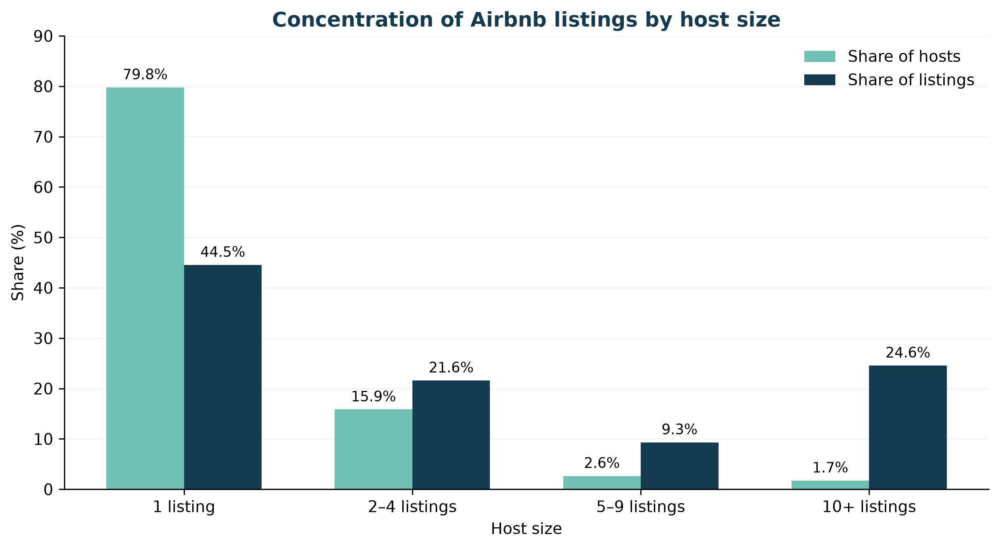
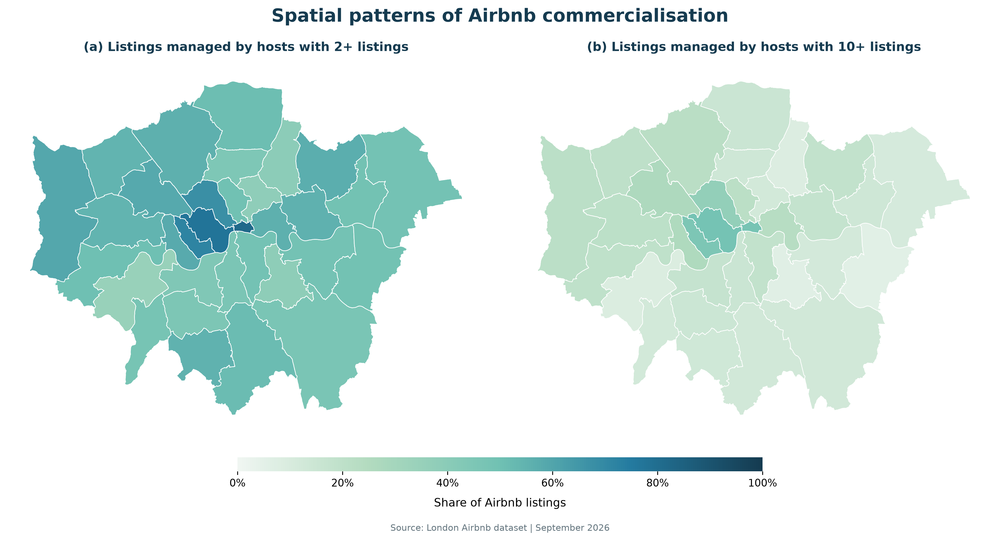
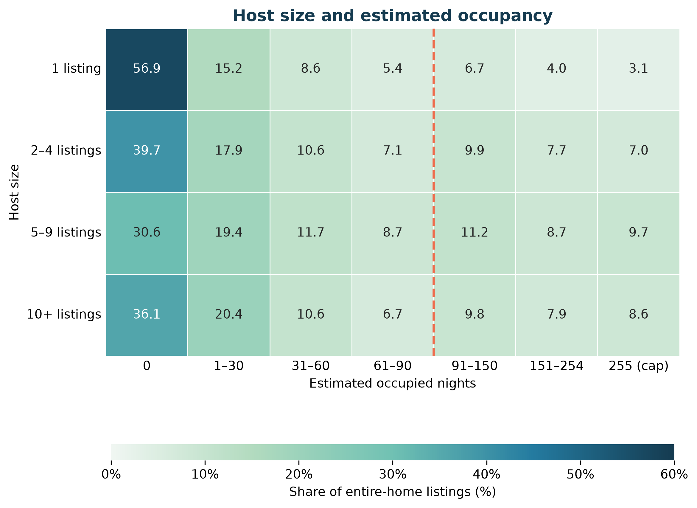
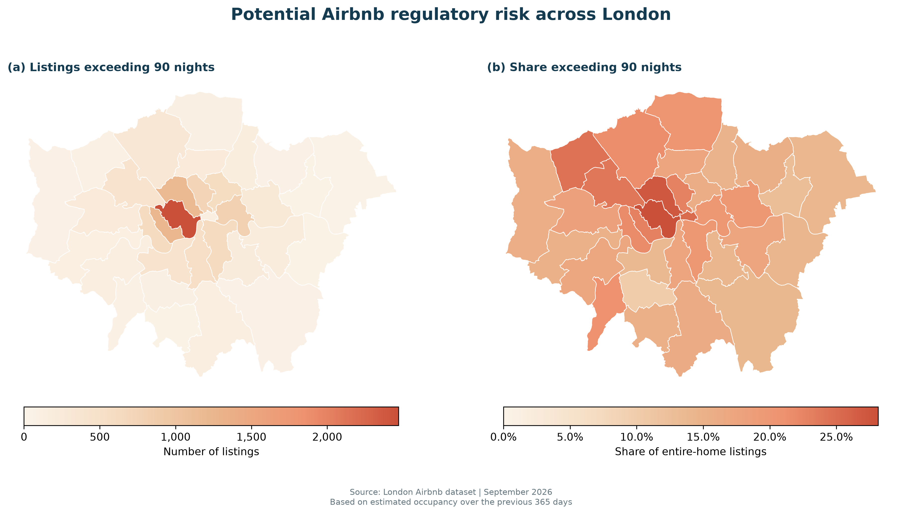
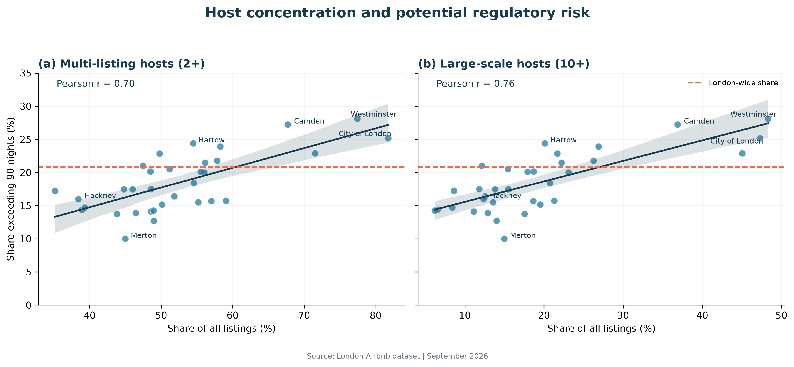

## Declaration of Authorship {.unnumbered .unlisted}

We, [jet2holiday], pledge our honour that the work presented in this assessment is our own. Where information has been derived from other sources, we confirm that this has been indicated in the work. Where a Large Language Model such as ChatGPT has been used we confirm that we have made its contribution to the final submission clear.

Date:

Student Numbers: 

## Priorities for Feedback

Are there any areas on which you would appreciate more detailed feedback if we're able to offer it?




# Briefing


In the midst of an election, a newspaper has broken the story of an advisor on social mobility to the Mayor owning three homes, two of which are let on Airbnb (one of which is still council-owned housing!). The opposition has announced a plan to force all *professional landlords* to register their properties and face higher Council Tax rates claiming that Airbnb is 'out of control' in the capital. 

The Mayor wants to understand the scale of the 'problem' and the likely impacts of the opposition's proposal so that they can either adopt it (and show how responsive they are) or demonstrate how poorly thought-through the opposition's proposal is (and show that they're not ready to govern). 

They have come to you---their crack team of data analysts and policy advisors---for a briefing supported by evidence and visualisations that they can use in their campaign communications. You are working in an information-poor environment, so you will need to make assumptions, justify them clearly, and show how they affect your conclusions. Use data, reasoning, and clear visualisation to build a persuasive and evidence-informed argument.

## What the Mayor wants to know

The Mayor has asked you to answer five key questions.

::: {.callout-important}
### Flexibility of Format

You will need to address the following five questions as part of your briefing, but you do *not* need to keep the question/answer format in your submission. I would like you to focus on effective communication: it must be clear that you *have* answered these questions in your briefing, but you don't need to keep these headings if they get in the way of your ability to communicate to the target audience.

:::

### 1. Is Airbnb 'out of control' in London?

Our findings suggest that Airbnb is partly out of control in London, although the situation varies considerably across the city. To assess whether Airbnb is out of control, we focus on three aspects: the spatial distribution of listings, estimated occupancy beyond the 90-night limit, and the proportion of listings managed by multi-listing hosts.

The borough-level map shows a clear concentration of Airbnb listings in Inner London. Westminster has the highest number of listings, exceeding 10,000, while Camden, Kensington and Chelsea, Tower Hamlets and Hackney also have relatively high numbers. In comparison, Outer London boroughs such as Havering, Bexley, Sutton and Bromley have considerably fewer listings. This suggests that the potential impact of Airbnb on local housing markets may vary across London. However, absolute listing counts alone cannot fully reflect pressure on housing supply, as the total housing stock differs between boroughs.

Of the 61,074 entire-home listings with occupancy estimates, 12,709 (20.81%) are estimated to have been rented for more than 90 nights in the past year. These listings are mainly concentrated in Central and Inner London, while those in Outer London are more dispersed. The results suggest that a considerable number of properties may require further regulatory investigation. However, estimated occupancy is not based on verified booking records, and properties exceeding 90 nights may have the necessary planning permission.

Another concern is that 55.45% of all listing records are associated with hosts managing multiple listings. This suggests that commercial operations may account for a substantial part of London's Airbnb market. If residential properties are used primarily for short-term holiday rentals, fewer properties may be available for long-term residents, potentially increasing pressure on the housing market. Nevertheless, managing multiple listings does not necessarily mean that a host owns several properties or operates as a professional landlord.

Overall, we consider Airbnb to be partly out of control, particularly in terms of potential regulatory non-compliance and commercialisation. However, the available evidence is insufficient to conclude that Airbnb is out of control across the whole of London. These findings highlight the need to identify professional landlords more accurately and understand how many properties would be affected by the opposition's proposed policy before assessing its wider benefits and drawbacks.


```{python}
## code01
## 运行环境：JupyterLab

# Data loading 加载数据
## Airbnb Data
## label: file-location-parquet
# Data loading 加载数据
## Airbnb Data
## label: file-location-parquet
import os
import pandas as pd
import geopandas as gpd

ymd  = '20260917'
city = 'London'
host = 'https://orca.casa.ucl.ac.uk'
url  = f'{host}/~jreades/data/{ymd}-{city}-listings.csv.gz'
file = f'{ymd}-{city}-listings.csv.gz'
if os.path.exists(file):
  try:
    df = pd.read_csv(file, low_memory=False)
  except:
    print(f"Unable to read csv '{url}'")
else: 
  try:
    df = pd.read_csv(url, low_memory=False)
    df.to_csv(file, index=False)
  except:
    print(f"Unable to download csv '{url}'")

## Read London borough boundaries
borough_url = (
    "https://gis.london.gov.uk/arcgis/rest/services/apps/BIDs_service_02/"
    "MapServer/6/query?where=1%3D1&outFields=NAME&outSR=4326&f=geojson"
)
boroughs = gpd.read_file(borough_url).reset_index(drop=True)
```
```{python}
#| include: false
%pip install adjustText
```
```{python}
# 伦敦 Airbnb分布图
import geopandas as gpd
import matplotlib.pyplot as plt
from adjustText import adjust_text
import matplotlib.patheffects as pe

# Convert longitude and latitude to points
map_df = df[["longitude", "latitude"]].dropna()
points = gpd.GeoDataFrame(
    map_df,
    geometry=gpd.points_from_xy(map_df["longitude"], map_df["latitude"]),
    crs="EPSG:4326",
)

# Match each point to its borough
joined = gpd.sjoin(
    points, boroughs[["geometry"]], how="left", predicate="within"
)

# Count records by borough and keep boroughs with zero matches
counts = joined["index_right"].value_counts()
boroughs["listing_count"] = boroughs.index.map(counts).fillna(0).astype(int)

boroughs_map = boroughs.to_crs("EPSG:27700")
label_points = boroughs_map.geometry.representative_point()

# Colour boroughs by listing count
fig, ax = plt.subplots(figsize=(10, 8))
boroughs_map.plot(
    column="listing_count",
    cmap="Reds",
    edgecolor="white",
    linewidth=0.6,
    legend=True,
    legend_kwds={"label": "Number of Airbnb listing records"},
    ax=ax,
)

# Add borough labels and move overlapping labels apart
labels = []
for name, point in zip(boroughs_map["name"], label_points):
    label = ax.text(
        point.x, point.y, name,
        ha="center", va="center", fontsize=6,
        path_effects=[pe.withStroke(linewidth=1.5, foreground="white")],
    )
    labels.append(label)

ax.set_title("Airbnb listings by London borough")
ax.set_axis_off()
fig.tight_layout()

adjust_text(
    labels,
    ax=ax,
    arrowprops={"arrowstyle": "-", "color": "0.45", "lw": 0.5},
)
plt.show()
```

```{python}
## code02
# 按照房东筛选，判断是否存在『一人多房』的情况，包括：同一房屋按部分出租 + 不同房屋整套出租

## Data munging
import pandas as pd
import plotly.express as px

# 按 host id 筛选数据
host_counts = (
    df.groupby("host_id")["id"]
    .nunique()
    .reset_index(name="listing_count")
)

multi_hosts = host_counts[
    host_counts["listing_count"] > 1
]

multi_listings = df[
    df["host_id"].isin(multi_hosts["host_id"])
].copy()

import pandas as pd
import plotly.express as px

# 给每个房东分组
host_counts["host_scale"] = pd.cut(
    host_counts["listing_count"],
    bins=[0, 1, 4, 9, float("inf")],
    labels=["1 listing", "2–4 listings", "5–9 listings", "10+ listings"]
)

# 用 listing_count 求每组房东掌握的房源总数
listing_summary = (
    host_counts.groupby("host_scale", observed=True)["listing_count"]
    .sum()
    .reset_index(name="listing_number")
)
```

```{python}
# 统计多房源房东掌握的房源占比 Share of listings controlled by multi-listing hosts

# 一句话概括情况
multi_listing_share = len(multi_listings) / len(df) * 100
print(f"Share of listings controlled by multi-listing hosts: {multi_listing_share:.2f}%")

# Data visualization
fig = px.treemap(
    listing_summary,
    path=["host_scale"],
    values="listing_number",
    color="host_scale",
    color_discrete_map={
        "1 listing": "#7A9DE1",
        "2–4 listings": "#FFE3EF",
        "5–9 listings": "#FFB9D5",
        "10+ listings": "#FF91BE"
    },
    title="Distribution of listings by host size"
)

fig.update_traces(
    texttemplate="%{label}<br>%{value:,} listings<br>%{percentRoot:.2%}",
    marker=dict(line=dict(color="white", width=2))
)

fig.update_layout(
    width=700,
    height=700,
    font=dict(size=13),
    margin=dict(t=60, l=10, r=10, b=10)
)

fig.show()
```

```{python}
# 在空间中的分布情况
```

```{python}
## code03
# 按照 estimated_occupancy_l365d > 90 为条件进行筛选，绘制这套房源出租超过90天的房屋
# limitation：本分析只能识别潜在监管风险，而不能直接认定是否违法
# 1.只能判断是否超过90天，无法判断是否非法  2.数据 estimated_occupancy_l365d 是过去365天的估计出租晚数  

## Data munging
# 筛选筛选整套出租房源
entire_homes = df[
    df["room_type"] == "Entire home/apt"
].copy()

# 排除估计出租晚数缺失的房源
valid_homes = entire_homes.dropna(
    subset=["estimated_occupancy_l365d"]
)

# 筛选出租超过 90 days 的
over_90 = entire_homes[
    entire_homes["estimated_occupancy_l365d"] > 90
].copy()

# 筛选估计出租未超过90晚的房源
under_90 = entire_homes[
    entire_homes["estimated_occupancy_l365d"] <= 90
].copy()

# 计算数量
total_entire = len(valid_homes)
over_90_count = len(over_90)

# 计算比例
over_90_pct = over_90_count / total_entire * 100

print(f"Entire home listings: {total_entire}")
print(f"Listings exceeding 90 nights: {over_90_count}")
print(f"Percentage: {over_90_pct:.2f}%")
```

```{python}
## Data visualization
# scatter plot 散点图
import geopandas as gpd
import matplotlib.pyplot as plt
# make the picture Clearly
from matplotlib_inline.backend_inline import set_matplotlib_formats
set_matplotlib_formats('retina')

# Convert longitude and latitude to points
over_90_points = gpd.GeoDataFrame(
    over_90,
    geometry=gpd.points_from_xy(
        over_90["longitude"], over_90["latitude"]
    ),
    crs="EPSG:4326"
)

under_90_points = gpd.GeoDataFrame(
    under_90,
    geometry=gpd.points_from_xy(
        under_90["longitude"], under_90["latitude"]
    ),
    crs="EPSG:4326"
)

# Plot London borough boundaries
fig, ax = plt.subplots(figsize=(7, 6))

boroughs.to_crs("EPSG:27700").plot(
    color="#F5F5F5",
    edgecolor="#B0B0B0",
    linewidth=0.6,
    ax=ax
)

# Plot listings under 90 nights
under_90_points.to_crs("EPSG:27700").plot(
    ax=ax,
    color="grey",
    markersize=1,
    alpha=0.3,
    label="90 nights or fewer"
)

# Plot listings over 90 nights
over_90_points.to_crs("EPSG:27700").plot(
    ax=ax,
    color="red",
    markersize=1.5,
    alpha=0.7,
    label="More than 90 nights"
)

ax.set_title(
    "Spatial distribution of entire-home Airbnb listings\n"
    "by estimated annual occupancy",
    fontsize=11
)

# Add Legend
ax.legend(
    loc="center left",
    bbox_to_anchor=(1.02, 0.5),
    title="Estimated occupancy",
    title_fontsize=9,
    fontsize=8,
    markerscale=5,
    frameon=False
)

ax.set_axis_off()

plt.tight_layout()
plt.show()
```

#### Additional evidence: host concentration and regulatory risk

Multi-listing hosts account for 20.22% of host accounts but manage 55.45% of all listing records. Accounts with ten or more listings represent only 1.73% of hosts but manage 24.55% of listings. This concentration suggests that the market extends beyond occasional home-sharing, although host accounts cannot be equated with property owners.

{#fig-q1-host-concentration width=90%}

The spatial distribution of multi-listing operations is uneven. In Westminster and the City of London, more than three-quarters of listings are associated with hosts managing multiple listings. The corresponding share in Hackney is 38.40%. High listing counts therefore do not necessarily imply high levels of host concentration.

{#fig-q1-commercialisation width=100%}

Among entire-home listings, the estimated share exceeding 90 occupied nights is 13.75% for single-listing hosts, compared with 24.61% for hosts with 2–4 listings, 29.67% for those with 5–9 listings and 26.22% for those with 10 or more. This suggests an association between host size and rental intensity, but the pattern is not strictly increasing.

{#fig-q1-occupancy width=95%}

Westminster has both the highest number (2,471) and highest proportion (28.13%) of entire-home listings estimated to exceed 90 nights. Harrow, by contrast, has only 93 such listings but a relatively high proportion (24.41%). Absolute counts may help identify where the largest investigative workload lies, while relative shares can highlight areas that might otherwise be overlooked.

{#fig-q1-risk width=100%}

Across the 33 London administrative areas, the proportion of entire-home listings exceeding 90 estimated nights is positively associated with the share of all listings managed by multi-listing hosts (Pearson r = 0.703) and by hosts managing ten or more listings (r = 0.759). Spearman correlations are also positive. Excluding Westminster, the City of London, Kensington and Chelsea and Camden reduces both Pearson coefficients, but the associations remain positive.

{#fig-q1-correlation width=100%}

| Host concentration indicator | Pearson (33 areas) | Spearman (33 areas) | Pearson (remaining 29 areas) |
|:--|--:|--:|--:|
| Share managed by hosts with 2+ listings | 0.703 | 0.623 | 0.459 |
| Share managed by hosts with 10+ listings | 0.759 | 0.699 | 0.600 |

: Correlation and sensitivity analysis. {#tbl-q1-sensitivity}

These are exploratory area-level associations, not causal estimates. Spatial dependence between areas, differing denominators and the absence of controls for local housing and tourism conditions limit interpretation. Estimated occupancy covers a rolling 365-day period rather than verified bookings in a calendar year; planning permission is also unobserved. Consequently, the 90-night indicator should be used for screening rather than as proof of a regulatory breach.

For the Mayor, the additional evidence supports targeted investigation in areas with high absolute counts or high relative shares, followed by verification of booking records and planning permissions. It strengthens the case for regulatory attention in particular areas but does not establish that Airbnb is out of control across London or that conditions have worsened over time.

### 2. How many professional landlords are there?

::: {.duedate}

Draft answer due Week 8.

:::
 
### 3. How many properties would be affected by the opposition's proposal?

::: {.duedate}

Draft answer due Week 9.

:::
 
### 4. What are the likely pros and cons of the opposition's proposal (for the Mayor, for residents, and for the city)?

### 5. Can the story be reframed as a positive one about social mobility or housing opportunity?

## References

## References